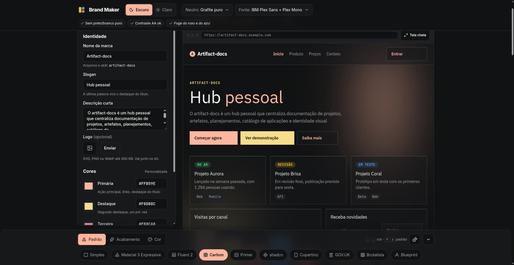
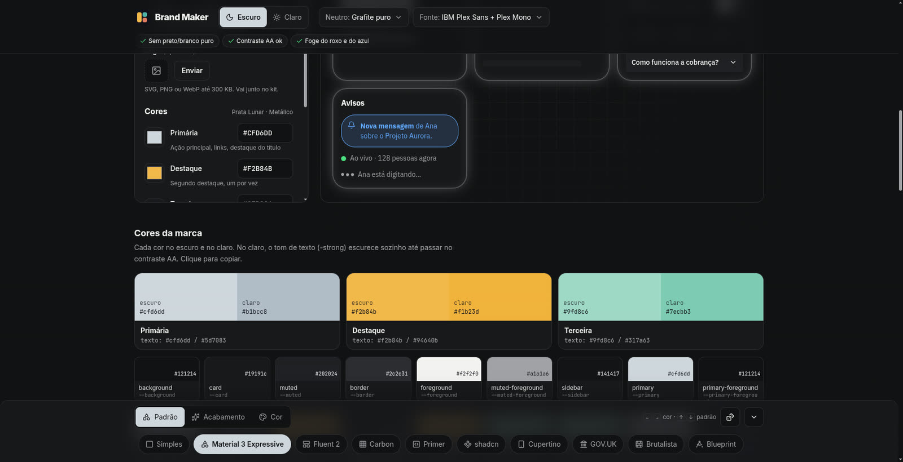

# Como usar

O Brand Maker tem três áreas: o **editor** (identidade e cores), a **prévia** (um site de
exemplo com a marca aplicada) e o **bottom sheet** (padrão, acabamento e cor). Tudo é salvo no
navegador; ao voltar, a última marca reabre.

## 1. Identidade

Nome, slogan, descrição curta e logo (SVG, PNG ou WebP até 300 KB). A última palavra do slogan
vira o destaque do título na prévia. O nome define o nome do zip (`minha-marca-design-kit.zip`).

## 2. Cor, padrão e acabamento (bottom sheet)

Na barra de baixo, uma escolha por vez:

- **Padrão**: a estrutura da interface (cantos, borda, sombra, altura dos controles,
  tipografia, movimento). Inspirado em sistemas conhecidos, sem logos nem fontes proprietárias.
- **Acabamento**: um efeito opcional por cima do padrão (vidro, neon, papel…). Não muda forma.
- **Cor**: paletas por grupo, em carrossel. Setas `←` `→` trocam a paleta e `↑` `↓` trocam o padrão.

Cada padrão muda a prévia inteira. No exemplo abaixo, a marca *Artifact-docs* com cores
personalizadas no padrão **Carbon**: cantos retos, botões altos e tipografia IBM Plex.

O dado faz uma combinação aleatória, e a seta recolhe a barra. No celular, a prévia vem primeiro e a
barra mostra só o texto das abas.

## 3. Topo: modo, neutros e fonte

- **Escuro / Claro**: a prévia e a ferramenta trocam juntas.
- **Neutro**: o tom dos fundos e bordas (tinta azulada, grafite puro, quente).
- **Fonte**: a do padrão ou um par fixo. A fonte vale só dentro da prévia; a ferramenta fica em Inter.
- **Regras**: sem preto/branco puro, contraste AA e "foge do roxo e do azul" (este último é só um aviso).

## 4. Seções da página

- **Cores da marca**: cada cor no escuro e no claro, e todos os tokens. Clique para copiar.
- **Contraste (WCAG)**: cada par texto/fundo com a nota AA, calculada ao vivo.
- **Leis de UX**: liga e desliga cada lei e ajusta os limites (ex.: alvo mínimo da Lei de Fitts).
- **Kit de design**: a lista de arquivos e o botão de baixar. Veja [o kit](kit.md).

## Tela cheia

O botão **Tela cheia** na prévia abre o site de exemplo ocupando a tela, com o bottom sheet
embaixo, para trocar cores e padrões vendo o resultado grande. `Esc` fecha.
